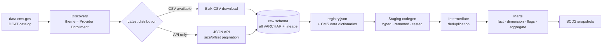

# CMS Provider Enrollment Analytics

An end-to-end analytics engineering project on dbt and DuckDB. It discovers every dataset
the Centers for Medicare & Medicaid Services (CMS) publishes under the **Provider Enrollment**
topic, ingests each on its native refresh cycle, and models the result into tested,
documented marts with row-level history.


| | |
|---|---|
| **Source** | [data.cms.gov](https://data.cms.gov) — Provider Enrollment topic, resolved via the DCAT catalog |
| **Coverage** | 33 datasets, ~18M rows (largest single file: 3.7M rows) |
| **Stack** | Python · dbt-core · DuckDB · dbt-utils |
| **Layers** | raw → staging (generated) → intermediate → marts · SCD2 snapshots |
| **Quality** | Key, referential, format, and source-freshness tests; lineage and docs via `dbt docs` |

---

## Architecture



The catalog is the source of truth. The ingester resolves the live dataset list on every
run, so files CMS adds or retires propagate through the pipeline without code changes.
Staging models, source definitions, and freshness thresholds are generated from what
actually landed; hand-written SQL is reserved for business logic.

## Data Sources

Representative datasets in scope (row counts and cadences per CMS dataset pages):

| Dataset | Grain | Rows | CMS refresh |
|---|---|---:|---|
| Medicare FFS Public Provider Enrollment | Enrollment record (NPI + enrollment ID) | multi-million | Quarterly |
| Order and Referring | NPI | 2.1M | Semiweekly |
| FISS Attending and Rendering | NPI | 2.1M | Semiweekly |
| Revalidation Reassignment List | Reassignment | 3.7M | Periodic |
| Revalidation Clinic/Group Practice Reassignment | Provider–group link | 3.5M | Periodic |
| Revalidation Due Date List | Provider | 3.0M | Periodic |
| Opt Out Affidavits | Affidavit | 59k | Monthly |
| Revoked Providers and Suppliers | Revocation | — | Quarterly |
| Opioid Treatment Program Providers | Provider | 1.6k | Weekly |
| Home Infusion Therapy Providers | Provider | 1.7k | Biweekly |
| Pending Initial L&T (Physicians / Non-Physicians) | Application | 4.1k / 7.6k | Semiweekly |

Also included: the Provider/Supplier Taxonomy Crosswalk and the facility enrollment,
ownership, and change-of-ownership files (Hospital, SNF, Home Health, Hospice, FQHC,
Rural Health Clinic). The full inventory is resolved at runtime.

## Design Decisions

**Runtime discovery over hardcoded endpoints.** Dataset UUIDs are resolved from the
catalog's `theme` metadata each run. A renamed dataset fails loudly at dbt parse time
rather than silently serving stale data.

**Raw layer preserves source fidelity.** Every column lands as VARCHAR, exactly as
published, with `_dataset_uuid`, `_loaded_at`, and `_source_url` lineage columns.
Typing happens once, in staging.

**Staging as generated code.** Casts are derived from each dataset's CMS data dictionary.
Identifier columns (NPI, enrollment IDs, codes, ZIPs) are pinned to VARCHAR regardless of
dictionary type; `try_cast` absorbs dirty values elsewhere, and key tests catch anything
important that nulls out.

**Load path chosen per dataset.** The latest CSV distribution is preferred — one request
for a 3.7M-row file. The JSON API is the fallback, with server-side page-cap detection and
buffered inserts every 200k rows to bound memory.

**History via snapshots.** CMS republishes full files with no per-row timestamps. A
check-strategy snapshot on the enrollment fact builds SCD2 history from the second run
onward; `hard_deletes='invalidate'` closes records when a provider leaves the file.

**Freshness from catalog metadata.** Each source table's `accrualPeriodicity` maps to
per-table `warn_after` / `error_after` thresholds, checked with `dbt source freshness`.

## Data Model

| Model | Grain | Purpose |
|---|---|---|
| `stg_cms__*` (33, generated) | Source grain | Typed, renamed, lineage preserved |
| `int_provider_enrollment` | NPI + enrollment ID | Deduplicated anchor records |
| `fct_provider_enrollment` | Enrollment record | Surrogate key, provider category, organization flag |
| `dim_provider` | NPI | Enrollment counts, state and provider-type lists |
| `provider_compliance_flags` | NPI | Presence across six status lists: enrolled, order/refer, opt-out, revoked, OTP, home infusion |
| `enrollments_by_state_type` | State × provider type | Enrollment and provider counts |
| `snp_provider_enrollment` | Enrollment record × version | SCD2 history, including ended enrollments |

The compliance-flags mart answers a common screening question in one lookup: whether a
given NPI is enrolled, eligible to order and refer, opted out, revoked, or enrolled in
OTP or home infusion therapy.

## Data Quality

| Check | Where | Mechanism |
|---|---|---|
| Key uniqueness / not-null | Fact, dimension, flags, anchor staging | `unique`, `not_null`, `dbt_utils.unique_combination_of_columns` |
| Referential integrity | `fct.npi → dim.npi` | `relationships` |
| NPI format (10 digits, numeric) | Fact | Singular SQL test |
| Source staleness | All 33 sources | `dbt source freshness`, cadence-derived thresholds |
| Duplicate-NPI watchlist | Order and Referring staging | `unique` at warn severity |

## Getting Started

Prerequisites: Python 3.10+, ~3 GB free disk, network access to `data.cms.gov`.

```bash
git clone https://github.com/<you>/cms-provider-enrollment-dbt.git
cd cms-provider-enrollment-dbt
python -m venv .venv && source .venv/bin/activate
make setup      # install dbt-duckdb, duckdb, ingestion dependencies
make refresh    # discover + ingest all datasets → generate staging → dbt build
make docs       # lineage graph and column-level documentation
```

`dbt build` runs models, snapshots, and tests in dependency order. Subsequent
`make refresh` runs advance the SCD2 history.

Iterate on a single dataset without touching the rest:

```bash
python ingest/cms_ingest.py --only order_and_referring   # registry merges
python ingest/cms_ingest.py --mode api                   # force the JSON API path
```

## Project Structure

```
├── ingest/
│   ├── cms_ingest.py            # catalog discovery, CSV/API load, registry.json
│   └── generate_staging.py      # registry → sources.yml, staging SQL, tests
├── models/
│   ├── staging/                 # generated — do not hand-edit
│   ├── intermediate/
│   └── marts/
├── snapshots/                   # SCD2 on the enrollment fact
├── macros/  tests/
├── dbt_project.yml  profiles.yml  packages.yml
└── Makefile
```

## Warehouse Portability

DuckDB is the default because the full topic fits comfortably on a laptop. The dbt layer
is adapter-agnostic apart from three functions (`split_part`, `string_agg`, `try_cast`),
all available on Databricks/Spark 3.4+. To run on a lakehouse: replace the DuckDB load
step with a Spark write to Delta, point `profiles.yml` at `dbt-spark`/`dbt-databricks`,
and adjust the `database`/`schema` values in the staging generator. Downstream models
are unchanged.

## Operations

A daily schedule on `make refresh` covers the fastest source (semiweekly). Snapshots
capture change history at each run; freshness thresholds flag any source that misses
its expected cycle. Full load is ~18M rows, a few hundred MB of downloads, and a
1–2 GB database file.

## Roadmap

- [x] GitHub Actions: scheduled refresh plus dbt build with state-based deferral on PRs
- [ ] Revalidation mart (due dates joined to reassignment chains)
- [ ] Union mart across facility enrollment files
- [ ] dbt exposures for downstream BI consumers

## Attribution & License

Data published by the Centers for Medicare & Medicaid Services via
[data.cms.gov](https://data.cms.gov); U.S. government works are public domain.
This project is not affiliated with or endorsed by CMS. Code released under the MIT
License — see `LICENSE`.

---

Built by **Balu** · [GitHub](https://github.com/<you>) · [LinkedIn](https://linkedin.com/in/<you>)
